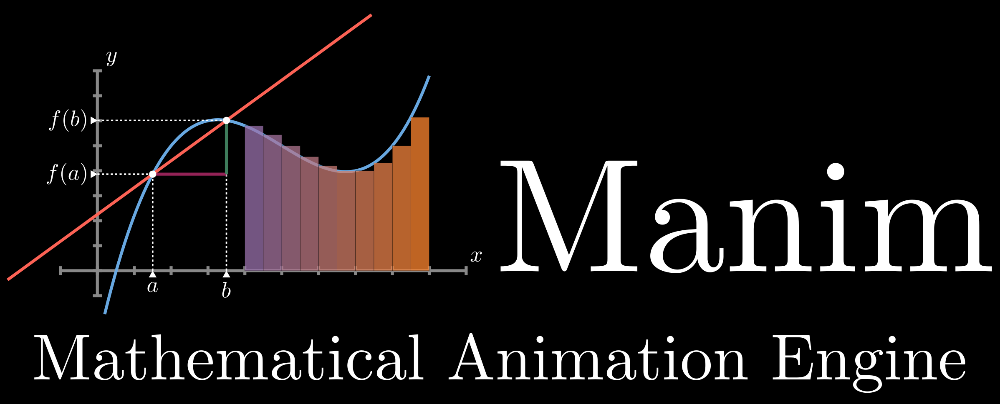

# Manim Project - Making AI & Dev accessible for all


[](http://choosealicense.com/licenses/mit/)
[](https://youtube.com/channel/UC_lqYWX_kD00D7yiZcrtBng/) 

## Overview

This project is dedicated to creating animations using Manim, a mathematical engine. The main objective is to visually illustrate algorithms, statistical and AI concepts. 
The animations are created in Python, leveraging Manim's extensive capabilities to produce high-quality visuals (https://github.com/3b1b/manim)

## Video Link
- [Manim Tutorial](https://youtu.be/ZsVbCt0uT0M)
- [DFS Video - FR](https://youtu.be/prcsjvhN_c8?si=x5BY5rC3O7wk8ZSK) 
- [DFS Video - ENG](https://youtu.be/gcrqye-KYvI?si=fzHtF3jvvSbl9dQV) 
- [French Executives Salaries Evolution (1996 to 2022)](https://youtu.be/rVqmQHxI0p4) 
- [Double Pendulum animation](https://youtu.be/k4zENntIkM0) 
- [Koch Snowflake ](https://youtu.be/5fwHVGms3Zw)
- [Linear Regression Animation](https://youtu.be/P-BVVLD41NM)
- [Statistic and parametric models](https://youtu.be/gGh_hHVSbD8)
- [Gaussian Distribution Visualisation](https://youtu.be/vMAus69cC74)
- [Taylor Series](https://youtu.be/qcLvkmPo7xo)
- [KMeans Clustering](https://youtu.be/HZLAqS1Dtg8?si=SpvLudKwOLQ3VeSP)
- [Galton Board](https://www.youtube.com/watch?v=c74jckgx80g)
- [Gaussiam Mixture Model (GMM)](https://www.youtube.com/watch?v=-RZWfmYhllQ)
- [Fourier Drawing](https://youtu.be/HBkDNkCT0UY)
- [Fractal Leaf Animation](https://youtu.be/-akETcacMAw)
- [Convolutional Neural Networks](https://youtu.be/vdqbAum4fuo)
- [Transformer](https://www.youtube.com/watch?v=g5r624CfeLE)
- [Cross Validation](https://www.youtube.com/watch?v=SF5qYhyY_9A)
- [Bias-Variance Tradeoff](https://www.youtube.com/watch?v=DZYCZg3mPtc)


## Repository structure

- `animations/<Name>/`: the explainer series, one film per folder (Transformer, KV Cache,
  Mixtral, Neural Network, LangGraph, …): `<name>.py`, `render.sh`, `README.md`, `assets/`
- `manimx/`: the shared library every film imports: crisp text and house font, palette,
  pacing, captions, intro/outro cards, glyphs, code panels, data-as-picture primitives
- `tools/`: `render_lib.sh` (the one render driver), `new_film.py` (scaffold a film),
  `lint_film.py` (house-rule checks), `edgecheck.py` + `contact_sheet.sh` (visual checks),
  `scene_fingerprint.py` (prove a refactor changed no frame)
- `animations/2024/`, `animations/CNN/`, `animations/Quant/`: the earlier series and notebooks
- `Simulations/`: matplotlib simulations in the same house style
- `.claude/skills/manim-explainer/`: the standards, quality bar and workflow for Claude
- `projects/`, `images/`, `assets/`, `docs/`: side projects, inputs, banner, documentation

## Getting started

```bash
cd animations/KVCache
./render.sh cache --quick --check   # first run creates the shared venv (~/.cache/manimx/venv)
./render.sh full -q h               # final 1080p60
python3 tools/new_film.py MyTopic "My Topic" "One-line promise"   # from the repo root
```

The explainers need Python 3.11+ and ffmpeg, no LaTeX. See **[docs/README.md](docs/README.md)**
for the full guide: the render driver and its knobs, the legacy scenes, notebooks, the RL
project and the dev tooling.

## Development

```bash
pip install -r requirements-dev.txt
pre-commit install
```

Linting and formatting run automatically on every commit via **pre-commit**
(`ruff` + `isort`). Run them across the whole repo with `pre-commit run --all-files`.
